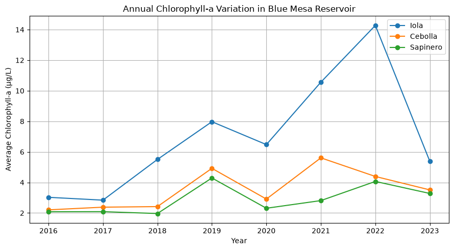
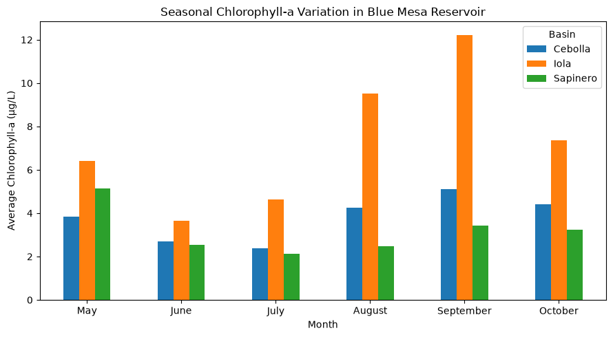
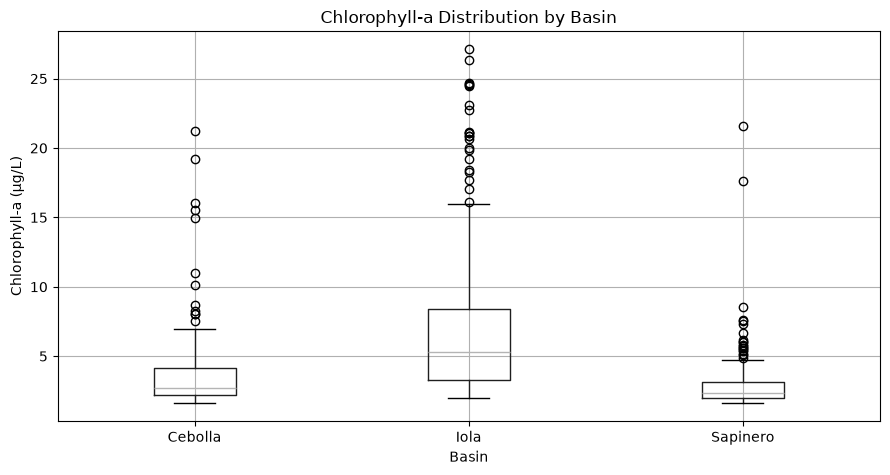

Chlorophyll-a in Blue Mesa Reservoir

CS 82A — Data Science

Student: Svetlana Babaeva

This project examines how chlorophyll-a concentrations varied among three basins of Blue Mesa Reservoir, Colorado, from 2016 to 2023, using USGS remote sensing data.
The dataset contains 497 records. The analysis includes data cleaning, basic statistics, and three charts: annual variation, seasonal variation, and basin comparison.

### Annual Variation

### Seasonal Variation

### Basin Comparison

The results showed that Iola had the highest average chlorophyll-a concentration (7.49 µg/L) and the greatest variation, compared with Cebolla (3.77 µg/L) and Sapinero (3.03 µg/L).

The analysis was completed in Python using JupyterLab. The results describe patterns in the available data but do not determine their environmental causes.

Data source: https://doi.org/10.5066/P9XULQAS

License: CC0 1.0 Universal (Public Domain).

How to run: Open blue_mesa_project.ipynb in JupyterLab with chl_rs_values.csv in the same folder and run all cells.

AI use: AI was used  just to help with Python syntax. Results were checked using the original data.
